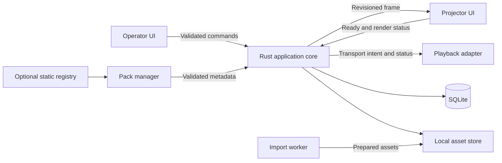

# System overview

The confirmed product boundaries are offline-first operation, separate operator and audience surfaces, independent slide and playback controls, and optional declarative content packs. The component design below is proposed. See [stack evaluation](tech-stack.md) and [ADR 0001](../decisions/0001-desktop-framework.md).

The core owns playlist mutations, active item identity, display lifecycle, and intended transport state. The playback adapter owns decoder state and reports observed transport status. Each webview owns its local view state. The projector consumes frame snapshots and can report readiness and render errors. It receives only the assets needed for its current frame. Extensions contribute data through the library and asset model. The projector renders generic frames regardless of source.

## Proposed boundaries

| Boundary | Contract |
| --- | --- |
| Operator to core | Typed intents such as Take, Next, SetMask, Stop and SetTarget. Validate window role and payload, serialize live intents, and return structured outcomes with a state revision. |
| Core to projector | Snapshot with window generation, revision, visibility mode, frame reference and layout. Renderer requests a full snapshot on startup or after a gap, and discards stale revisions. |
| Core to media | Prepare, play, pause, seek, stop and set volume. Events include transport generation so late callbacks cannot mutate the next item. |
| Import to storage | Preparation jobs produce checked, immutable assets before committing references. Results return as success or actionable failure. |
| Registry to packs | Optional HTTPS fetch initiated from extension management. Installed pack records and local data drive offline operation. |

Use window-specific Tauri capabilities, restricted asset access and a local-content policy. Resolve opaque asset IDs in the core and expose only approved assets. No renderer gets arbitrary filesystem access or shell commands. Keep background conversion and network downloads off the live event path. Use bounded diagnostic logs with revision, timing and error category while excluding lyric text and full private paths by default. Live state starts cleared after restart. Persist preferences and saved programs separately. See [projection](projection-engine.md), [media](media-engine.md) and [data](database-design.md). [Tauri process model](https://v2.tauri.app/concept/process-model/) · [Tauri asset protocol](https://v2.tauri.app/es/security/asset-protocol/)
